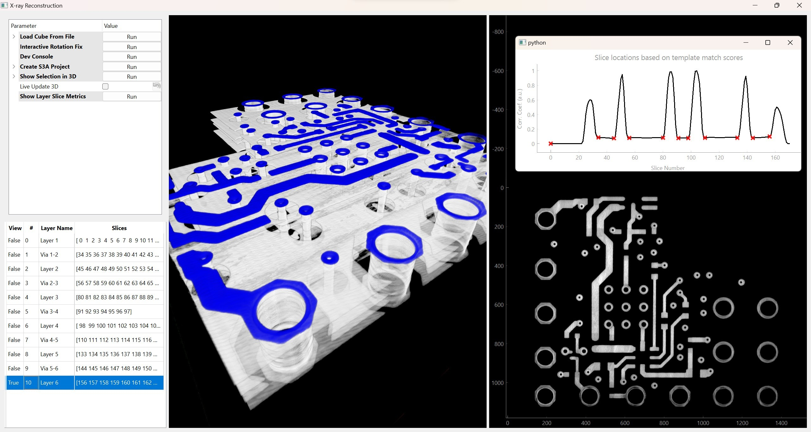

# Xray Reconstruction and Layer Segmentation Tool


A tool for working with 3D X-ray CT volumes of Printed Circuit Boards (PCBs).
It loads real CT data and/or a Gerber PCB design, renders both in a
dual-pane 3D viewer, and can register the Gerber model's known geometry onto
real CT data to auto-label materials voxel-by-voxel. Individual layers can
also be annotated through [S3A](https://gitlab.com/s3a/s3a) to indicate
netlist-specific information.

## Documentation
- [Architecture Overview](./xrayrecon/ARCHITECTURE.md)

## Installation
Clone the repository and install the package and test dependencies in editable mode:
```bash
git clone <repo-url>
cd Sandia_Project
pip install -e ".[test]"
```

Dependencies: PyQt5, PyQtGraph, qtextras, S3A, NumPy, SciPy, scikit-image,
OpenCV, pandas, matplotlib, Pillow, pygerber, tifffile, fire.

## Running the App
```bash
# Launch with phantom data (no file required)
python -m xrayrecon.main

# Launch with a .npy volume file
python -m xrayrecon.main --datafile /path/to/volume.npy

# Launch with a directory of image slices
python -m xrayrecon.main --datafile /path/to/image_dir/
```

The toolbar's "Tools" panel also has demo actions that need no data of your
own: **Load Phantom Demo** and **Load PCB Registration Showcase**. The PCB
showcase loads a recognizable board with chips, pins, routed traces, vias,
mounting holes, connector shell, gold fingers, fiducials, and passives. Its
blurred/noisy CT-like scan and clean material-colored Gerber model have a
known misalignment, so the complete embedded registration and label-transfer
workflow can be exercised against a known-correct answer. See the
[PCB Showcase Walkthrough](./xrayrecon/SHOWCASE_DEMO.md).

After loading the showcase, **Run Showcase Z-effective / Electron Density**
runs the Alvarez-Macovski component on the same canonical material ground
truth. The AM Color controls then switch the left pane among recovered
Z-effective, electron-density, and approximate-material views while the
embedded quantitative workspace shows ground truth, raw or
material-regularized recovery, projection residual, and reconstruction
confidence. Electron density is labeled relative to water and is also retained
in `10^23 electrons/cm3`; raw recovered arrays remain available for audit.
The showcase now applies a separately fitted synthetic reference calibration,
shows nominal 90% uncertainty maps, and labels that provenance explicitly. It
does not claim measured-scanner validation.

Use **Tools → Regenerate Z_eff / rho_e Plot** to reopen Quantitative AM analysis
with the most recent decomposition result. The matching View action opens the
same screen. **Return to Viewer** brings you back to the 3D workspace; reopening
analysis uses the cached result without running the simulation again.

## Simulation Metrics

CT and AM simulations print one compact terminal line with the button/action
name, CPU or GPU, total elapsed time and step times. All displayed times are
truncated to two decimal places in seconds. CT shows projection/backprojection;
AM shows acquisition, reconstruction (with basis/residual backprojection times),
and fidelity-metric calculation. The displayed total includes setup, transfers,
reconstruction and metric calculation; it excludes prior Gerber voxelization
and display rendering. The verbose JSON print calls are commented out.

The Gerber stackup editor defaults to **GPU (CUDA)** when PyTorch reports an
available CUDA device, and to **CPU** otherwise (including when optional
PyTorch cannot load). You can change the processor manually; reopening the
editor preserves your choice for the current session.

GPU selection uses
CUDA FFT filtering and a custom parallel backprojection kernel for CT and AM,
including AM residual maps. AM LUT interpolation and regularization remain on
CPU. First CUDA runs include initialization and runtime compilation costs.

The stackup editor supplies sample and spacing metadata automatically. Direct
Python calls can pass `sample_file=` and `voxel_spacing_mm=`; unavailable metadata
is `null`. AM retains the detailed record as `result.run_metrics`, keeping its
dictionary values exclusively arrays. Sample/settings/device details are retained
there for studies and are omitted from terminal summaries. No source files or
metric files are written by simulations.

AM compares raw and material-regularized Z-effective/electron-density volumes
against the matching synthetic ground truth. `result.reconstruction_metrics`
retains SNR in dB and SSI (structural similarity, SSIM); the analysis panel shows
these for the selected slice and display mode, including calibrated outputs.
Fidelity calculation time is retained as `metrics_elapsed_s`; the detailed
simulation `elapsed_s` excludes it, while the compact displayed total includes
it. Metrics include background and boundaries.
No ground truth means no fidelity claim. SSI uses a reference-only data range,
without independently normalizing the reconstruction. Constant references and
images smaller than three pixels per side report unavailable SSI.

For a reproducible before/after timing study:
```bash
python -B benchmarks/benchmark_cuda_backprojection.py --repeats 5 --output benchmarks/backprojection_study.json
```
This compares CPU, the previous partial GPU workflow, and the GPU workflow with
backprojection enabled. Direct calls can select `backprojection_backend="cpu"`
to reproduce the previous workflow; by default it follows `projection_backend`.
CUDA-enabled PyTorch must include NVRTC; no system CUDA/C++ compiler is needed.
See [Simulation Metrics and CUDA Backprojection](./xrayrecon/SIMULATION_METRICS.md)
for definitions, timing scope, algorithm assessment, and measured results.

## Running Tests

```bash
python -m pytest
```

The canonical test configuration lives in `pyproject.toml`. Core algorithm
tests do not require a display; Qt tests set the offscreen platform in their
shared fixture. Use `python -m pytest -m "not slow"` for the normal development
regression loop.

## Key Features
- **Dual-pane 3D viewer** (`gui/app.py`): real CT data on the left
  (`viewer_3d_left`), Gerber-derived model on the right (`viewer_3d_right`),
  each with independent camera/threshold/opacity controls.
- **Gerber stackup + materials** (`gui/stackup_editor.py`, `stackup.py`,
  `voxelizer.py`, `materials.py`): assign a material to every Gerber layer
  and voxelize into a 3D volume.
- **Embedded registration** (`registration.py`, `gui/registration.py`): an
  in-application 5-DOF (XYZ translate + Z-rotation + uniform scale) workspace
  with a live red/green overlay, bounded initial-alignment suggestion, explicit
  acceptance, and stale-input protection.
- **Label transfer**: once registered, the Gerber model's known per-voxel
  materials are resampled onto the real CT grid to auto-label it.
- **Simulated X-ray / CT bridge** (`ct_simulation.py`): a true Radon +
  filtered-back-projection simulation of a Gerber stackup, for validating
  registration/label-transfer logic on deterministic abstract and
  interpretable PCB pairs
  before tackling real, misaligned CT data.
- **Alvarez-Macovski dual-energy decomposition** (`alvarez_macovski.py`,
  `gui/am_plot_window.py`): recovers Z_eff / electron-density per voxel from
  a deterministic noiseless or seeded Poisson dual-energy scan, with explicit
  relative/absolute electron-density units, projection residual, confidence,
  volume colorization, and material classification against the materials database.
- **Acquisition and calibration** (`am_acquisition.py`, `am_calibration.py`):
  validated JSON spectra/geometry/provenance, strict paired `.npy` projection
  import, held-out material calibration, and empirically checked uncertainty.

## Package Structure
```
xrayrecon/
├── main.py                  # Entry point; generates phantom data if no file given
├── io.py                    # Load .npy files or image directories into 3D arrays
├── io_spectral.py           # Load spectral/energy-decomposed ("ED") CT data
├── layerseg.py              # Layer segmentation via template matching + peak detection
├── stackup.py                # PCB stackup representation (StackupConfig)
├── stackup_voxelize.py       # Pure (no-Qt) Gerber stackup -> voxel volume pipeline
├── voxelizer.py               # Convert 2D stackups (Gerber) to 3D voxel grids
├── convert.py                # Data conversion utilities
├── materials.py               # Material property definitions (Z_eff, density, colors)
├── material_seg.py            # Threshold-based material segmentation of a volume
├── multimaterial.py           # Multi-material config (per-threshold color/material)
├── registration.py            # Rigid+scale transform, mm-based volume/label resampling
├── synthetic_registration.py  # Deterministic registration demos/regression cases
├── ct_simulation.py           # Radon + FBP simulation of a real CT scan
├── alvarez_macovski.py        # Dual-energy decomposition, colorization, classification
├── am_acquisition.py          # Serializable spectra, geometry, projection provenance/import
├── am_calibration.py          # Material calibration and empirical uncertainty intervals
├── gerber_utils.py            # Gerber file parsing helpers
├── pygerber_integration.py    # Gerber file rasterization via pygerber
├── cubecorrections/
│   ├── rotation.py            # Volume rotation utilities
│   └── emptyslices.py         # Empty-slice detection/removal
├── configs/                   # Example Gerber stackup / multi-material JSON configs
├── tests/                     # pytest suite (registration math/state, materials, spacing, smoke)
└── gui/
    ├── app.py                # MainWin — main window, dual-pane coordination hub
    ├── layermodel.py         # LayerModel — data cube, layer metadata, voxel spacing
    ├── layerview.py          # 2D slice visualization
    ├── view3d.py             # PCBViewer3D — OpenGL 3D volume rendering
    ├── table.py              # Layer selection table
    ├── stackup_editor.py     # Non-modal Gerber layer/material assignment table
    ├── spacing_dialog.py     # Dialog for entering real-CT voxel spacing (mm/voxel)
    ├── registration.py       # Embedded RegistrationPanel workspace
    ├── am_plot_window.py     # Embedded quantitative Alvarez-Macovski workspace
    └── helpers.py            # Shared GUI utilities and phantom data generation
```

## Confidence-Guided Registration

Open **Register Gerber to Real CT...** after loading both volumes and confirming
their voxel spacing. The main workspace switches to the embedded registration
panel, which continuously displays an alignment score from `0` to `1`.
**Suggest Initial Alignment** performs a deterministic,
bounded search over XYZ translation, in-plane rotation, and uniform scale, then
places the best result in the existing controls for manual review. It does not
accept the transform or transfer material labels.

The score correlates robustly normalized intensity and boundary features from
the fixed CT and resampled Gerber volumes. It is intended only to compare
candidate transforms for the same volume pair. The displayed low/moderate/high
confidence is a conservative summary of the score and its improvement over the
identity transform; it is not a probability, accuracy guarantee, or substitute
for inspecting the red/green overlay.

The interactive search is intentionally limited to translations within 25% of
the fixed-volume extent, rotations within 15 degrees, and scales from 0.8 to
1.2. Registrations outside those ranges, boards with repeated/symmetric
features, cropped data, weak contrast, or large Gerber/CT material-intensity
differences may produce a low-confidence or incorrect suggestion. Adjust the
five controls directly to override it, use **Reset** to return to identity, and
select **Accept** only after reviewing the overlay. Label transfer remains a
separate explicit action in the main window.

Use **Back to Main Workspace** to return to the normal dual-pane view. The
current edit is preserved while the CT/Gerber inputs and physical spacing remain
unchanged; replacing either dataset invalidates stale accepted registration.

See [`xrayrecon/REGRESSION_TESTING.md`](xrayrecon/REGRESSION_TESTING.md) for the
test tiers, synthetic-case contract, warning policy, and CI expectations.
