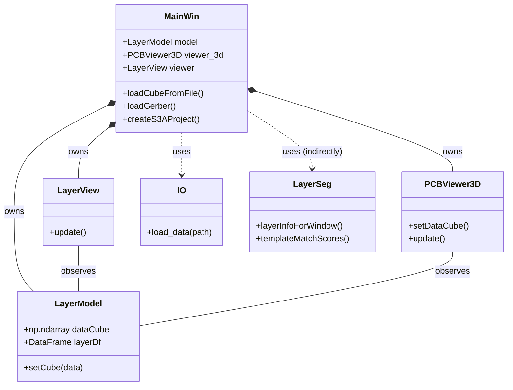

# X-Ray Reconstruction App Architecture

## Overview
The **X-Ray Reconstruction App** is a Python-based desktop application designed for analyzing and reconstructing 3D X-ray volumes of Printed Circuit Boards (PCBs). It allows users to load 3D data (from files or image directories), visualize it in 3D, and perform layer segmentation.

Key technologies:
- **PyQt5**: User Interface.
- **PyQtGraph**: 2D plotting and 3D visualization (OpenGL).
- **S3A**: Annotation and project management integration.
- **NumPy/SciPy/OpenCV**: Data processing and analysis.

## High-Level Code Structure

The project is organized into the `xrayrecon` package. The entry point is `main.py` which initializes the `MainWin`.

### Directory Layout
- **`xrayrecon/`**: Main package.
    - **`main.py`**: Application entry point. Handles argument parsing and bootstrap.
    - **`io.py`**: Data loading logic (supports `.npy`, image directories).
    - **`layerseg.py`**: Algorithms for segmenting the 3D volume into layers using template matching and peak detection.
    - **`voxelizer.py`**: Logic for converting 2D stackups (like Gerber files) into 3D voxel grids.
    - **`pygerber_integration.py`**: Handling of Gerber file rasterization.
    - **`gui/`**: GUI components.
        - **`app.py`**: Contains `MainWin`, the main application window and coordination center.
        - **`view3d.py`**: `PCBViewer3D` class for 3D visualization.
        - **`layermodel.py`**: `LayerModel` class managing the data cube and layer metadata.
        - **`layerview.py`**: `LayerView` for 2D slice visualization.

## Architecture Diagram

## Component Details

### `MainWin` (xrayrecon.gui.app)
The central hub of the application. It:
- Initializes the `LayerModel`.
- Sets up the UI (plots, tables, 3D viewer).
- Registers tools (ParameterEditor) for actions like loading files (NPY, Gerber), creating S3A projects, and fixing rotation.
- Connects signals from the selection table to update the 3D view.

### `LayerModel` (xrayrecon.gui.layermodel)
Holds the state of the loaded data:
- `dataCube`: The 3D numpy array representing the volume.
- `layerDf`: A pandas DataFrame storing information about identified layers (slices, names).

### `IO` (xrayrecon.io)
Handles data ingestion.
- `load_data`: Detects if the input is a directory (sequenced images) or a `.npy` file and loads it into a 3D array.

### `LayerSeg` (xrayrecon.layerseg)
Provides the algorithmic core for analyzing the 3D volume to find layers.
- Uses template matching (`cv.matchTemplate`) across Z-slices to find correlation scores.
- Uses peak detection (`scipy.signal.find_peaks`) on these scores to identify distinct PCB layers and vias.

### `PCBViewer3D` (xrayrecon.gui.view3d)
Handles the OpenGL rendering of the voxel data using `pyqtgraph.opengl`. It supports features like downsampling and transparency adjustment for better visualization performance.
